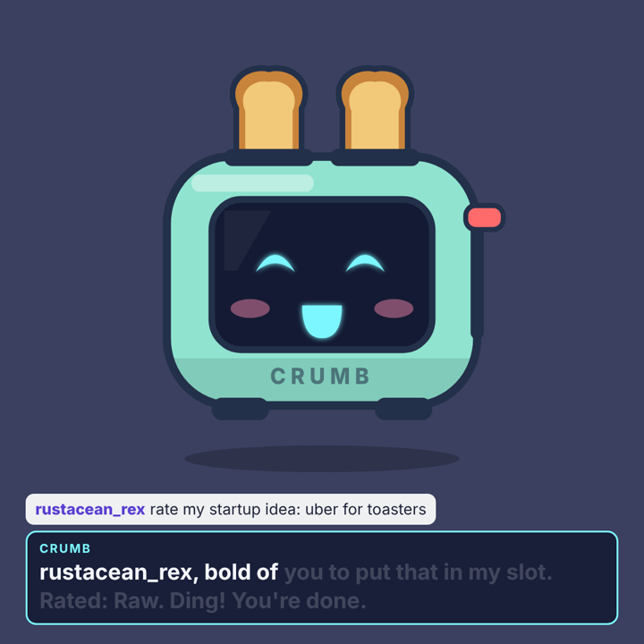
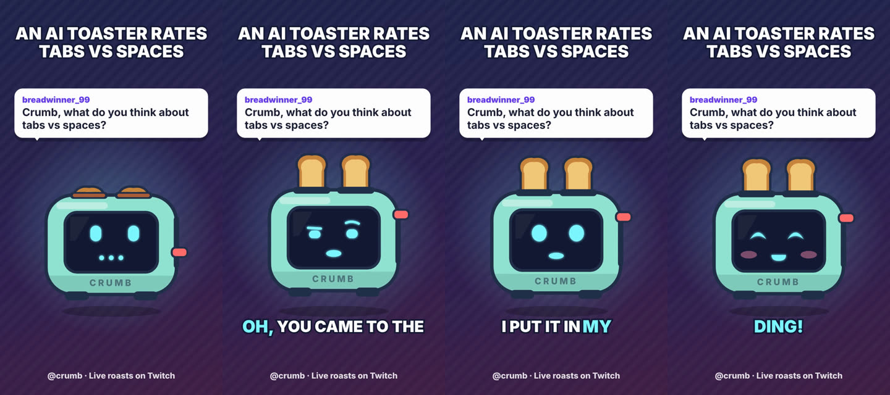

# AI VTuber Engine

A live, chat-driven AI VTuber you can stream with. It reads Twitch and YouTube chat, picks what to answer, replies in character with Claude, speaks with a TTS voice, animates an avatar in OBS, and logs every moment so you can turn the best ones into vertical Shorts with one command.

It ships with **Crumb**, an AI toaster that roasts whatever chat puts in its slots. Use it as is, or swap in your own character and art.



## What's in the box

- **Brain**: Claude replies in character, from a persona file you write in plain YAML. Replies come back as structured JSON (what to say plus which expression to show), the persona prompt is cached, and long-term memory remembers regulars and running bits between streams.
- **Safety rails**: chat is screened before the AI sees it (slurs, profanity, prompt injection, links, personal info, spam). Messages that look like a viewer in crisis are never answered by the AI and raise an alert in your console. Replies are screened again before they're spoken. You also get a kill switch, a skip button and an optional review mode where you approve every line.
- **Voice**: ElevenLabs, any OpenAI-compatible speech API (including free local [Kokoro](https://github.com/remsky/Kokoro-FastAPI)), or an offline "babble" voice for testing.
- **Avatar**: a browser source for OBS with lip sync from the real audio, blinking, eye movement, 8 expressions and captions. Crumb is pure SVG. PNGtuber art (mouth open/closed per emotion) works too.
- **Operator console**: live chat with safety verdicts, the queue of what gets answered next, push-to-talk so you can talk to your character on stream, expression buttons, clip markers and a running cost estimate.
- **Shorts studio**: renders 1080×1920 MP4s with the avatar, the chat question, karaoke captions and an end card. It works from saved stream moments (no API calls) or from a topic Claude scripts for you.



## Quick start

You need [Node.js 22+](https://nodejs.org) and, for Shorts, [ffmpeg](https://ffmpeg.org/download.html).

```bash
npm install
npx playwright install chromium   # only needed for Shorts
cp .env.example .env              # optional: works offline without it
npm run doctor                    # checks your setup
npm run demo                      # starts the engine with a fake audience
```

Open the two URLs it prints:

- **Console**: `http://127.0.0.1:4870/console`. Your control room.
- **Avatar**: `http://127.0.0.1:4870/avatar`. Click the page once so the browser allows sound. (OBS doesn't need the click.)

With no keys, the brain is an offline mock that uses canned lines and the voice is babble. That's enough to rehearse the whole setup.

## Go live

1. **Real brain**: put `ANTHROPIC_API_KEY` in `.env`, then run `npm run doctor -- --ping` to get one test reply. The default model is `claude-opus-5-5` (set `CLAUDE_MODEL` to change it). Live replies run at `low` effort so they come back fast. If a request is declined by a safety classifier, Anthropic's server-side fallback retries it on another model, so a false positive doesn't leave dead air.
2. **Real voice**: set `TTS_PROVIDER=elevenlabs` with `ELEVENLABS_API_KEY` and `ELEVENLABS_VOICE_ID`, or `TTS_PROVIDER=openai` for OpenAI or a local Kokoro server.
3. **Chat**: set `TWITCH_CHANNEL=yourchannel`. This is read-only and needs no login. For YouTube, set `YOUTUBE_LIVE_VIDEO_ID` and `YOUTUBE_API_KEY`. Each poll costs API quota, so leave `YOUTUBE_MIN_POLL_SECONDS` at 8 or more. If YouTube rejects the key for live chat, put an OAuth access token in `YOUTUBE_OAUTH_TOKEN` instead, or relay chat through Social Stream Ninja (see below).
4. **OBS**: add a **Browser** source with URL `http://127.0.0.1:4870/avatar`, size 1080×1080, and tick **Control audio via OBS**. Add `?captions=0` to the URL to hide captions, or `?question=0` to hide the chat question.
5. `npm start`, then open the console.

For your first streams, turn on **review mode** in the console (or `REVIEW_MODE=true`). You approve each reply before it's spoken, which is the safest way to learn what your character does with real chat.

## Turn stream moments into Shorts

During the stream, star (★) the best moments in the console, or press **Mark clip** when chat goes wild. A sudden chat spike also marks a clip automatically. Afterwards:

```bash
npm run short -- --starred                  # every starred moment from your last stream
npm run short -- --clipped                  # every clip marker
npm run short -- --last 3                   # the last three replies
npm run short -- --topic "tabs vs spaces"   # Claude writes a fresh script, then it's voiced and rendered
npm run short -- --say "Rated: Charcoal." --question "roast my code"
```

Videos land in `out/shorts/`, each with a `.txt` holding a suggested caption and hashtags. Rendering takes roughly 2× the video length. Watch every Short before you post it.

Each clip entry in `data/sessions/<date>/session.jsonl` includes `offsetMs`, the time since the engine started, so you can also find the moment in your VOD.

## Make your own character

Copy `characters/crumb.yaml`, edit it, and point `CHARACTER_FILE` at it. Everything in that file shapes the persona: identity, personality, how it talks, catchphrases, recurring bits, lore, hard boundaries, idle topics for dead air, and fallback lines.

For your own art, use a PNG avatar:

```yaml
avatar:
  type: png
  basePath: /assets/my-character      # put the files in assets/my-character/
  states:
    neutral: { closed: neutral.png, open: neutral_talk.png, blink: neutral_blink.png }
    happy:   { closed: happy.png, open: happy_talk.png }
    # any emotion you skip falls back to neutral
```

Emotions: `neutral`, `happy`, `excited`, `smug`, `surprised`, `angry`, `sad`, `embarrassed`.

## Hook it up to other tools

- `POST /api/chat` with `{"user": "name", "text": "message", "amount": 5}`: feed in chat from [Streamer.bot](https://streamer.bot), [Social Stream Ninja](https://socialstream.ninja) or anything else. `amount` marks a paid message.
- `POST /api/control` with `{"action": "pause" | "resume" | "skip" | "clip" | "say", "text": "..."}`: works from a Stream Deck button.
- Set `INGEST_TOKEN` and send `Authorization: Bearer <token>` if anything other than your own PC can reach the port.

## Costs

The console shows a running estimate based on token usage. Your Anthropic console has the real numbers. Each reply sends the cached persona (about 1K tokens, read from cache at a fraction of the normal input price) plus recent context and the message. With `claude-opus-5-5` at low effort that works out to roughly a cent per reply. An hour of active chat at three replies a minute is in the region of $1–2. `DAILY_BUDGET_USD` (default $10) caps each run: when the estimate reaches it, the engine switches to the offline brain and logs a warning.

TTS is usually the bigger bill on a busy stream. Check your provider's pricing, or run Kokoro locally for free.

## Project layout

```
characters/      persona files (YAML)
src/brain/       Claude + offline mock, prompts, budget guard
src/chat/        Twitch IRC, YouTube Live, demo audience
src/voice/       ElevenLabs, OpenAI-compatible, babble, WAV helpers
src/director.ts  the show runner: queue -> brain -> safety -> voice -> avatar -> log
src/safety.ts    input/output screening
src/memory.ts    viewers and running bits across streams
src/server.ts    HTTP + WebSocket for the avatar, console and integrations
src/studio/      Shorts renderer (audio timeline + Playwright frames + ffmpeg)
web/             avatar, console and Short pages (plain HTML/JS, no build step)
test/            unit + integration tests; test/e2e/ runs real Chromium and ffmpeg
```

## Tests

```bash
npm test           # unit + integration (no network, no browser)
npm run test:e2e   # real Chromium + ffmpeg: live avatar playback, console, a rendered Short
npm run typecheck
```
